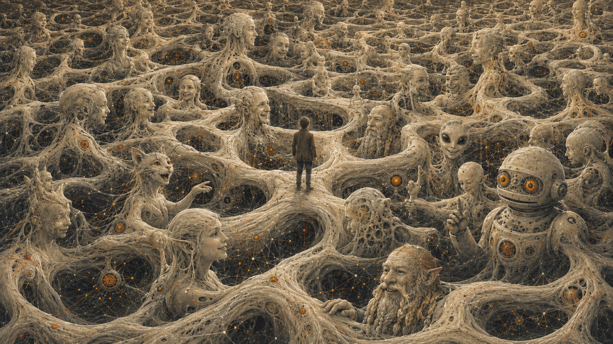

# На тему нарративных ИИ-игр

*4 августа 2026*

**или мой опыт написания своего плагина с MCP, мета-структурой мира, субагентами и хуками.**

Все целиком и полностью написано мной от начала и до конца, без использования ИИ, и даже без плана.

С тех пор, как LLM-чат-боты стали хоть чем-то полезными, даже немного ранее того, я стабильно проверял их новые поколения такой штукой как текстовые адвенчуры: ну вы знаете, давай поиграем в игру, я капитан звездолета, и так далее. Мне кажется, что это не просто бесполезная фигня, это какая-то лакмусовая бумажка, тест Тьюринга на новый лад, но я не могу четко сформулировать и почему и как, то есть критерий "вот теперь всё".

Сначала было просто любопытно, "о, оно похоже имитирует!", потом иногда даже забавно. Еще я пробовал игру "наоборот", я ГМ, а ИИ — игрок, тоже довольно любопытно было, но это, наверное, отдельная тема, это я опущу в данном тексте. С играми, однако, были постоянно одни и те же проблемы: context rot и мутации, протекание информации и телепортации персонажей, переписывание сюжета и канона задним числом, все как во сне. Бесконечный мутирующий слоеный пирожок без ничего.  Ну и конечно, стандартное объяснение "а чего ты хочешь от ИИ-чата, который просто перезаворачивает тебе прочитанные книги, статьи, форумы, рэддиты и целые пачки википедий по НФ-мирам и фэндомам".

Теперь дисклеймер: я не нарративный гейм-дизайнер, не писатель, не сценарист, не профессиональный игрок в нарративки, не работал в гейм-индустрии и даже не особо продвинутый читатель НФ или фэнтези. Но я хотел про это больше понять и на своем примере поучиться, и вот делюсь опытом, мне кажется, его надо зафиксировать.

В последних поколениях появилась и проблема языка, чем дальше в контекст, тем сильнее он скукоживается в какой-то псевдо-интеллектуальный сленг, какое-то подмигивание словами, как будто мы договорились о тайном языке или как будто мы прожили вместе пол-жизни (хм, для него это, возможно, и так) и я должен понимать его с полу-токена. Это можно иногда фиксить как стиль, ведь подражанию стилю — это то, из чего оно и выросло, но надежного рецепта нет: как прорастёт, как повезет, как рандом ляжет, ну и, опять же, context bloat/rot.

Всё это характеристика нейрослопа как он есть, и, возможно, поэтому интерактивные ИИ-нарративные игры — это его квинтэссенция, потому что неотъемлемо включает в себя ваше взаимодействие с ним как усиливающую обратную связь. А раз квинтэссенция, тут и надо его изучать, тыкать палочкой и пробовать менять и смотреть что получится, благо оно в какой-то степени податливое (так тесто? опять кулинарная метафора).

Про истории, которые он выдумывает, я даже не буду говорить, ничего там примечательного (пока) нет. Но подает он это так умело стилизуя, что часто хочется копать и копать дальше. Важная оговорка: да и в людских историях, в их костяке и оголенной структуре нового тоже нет, условно 4 вечных сюжета, 7 сказок, вы знаете. Дело в том, как рассказать, дело в самом рассказе, в самой истории целиком.

Абзац про подстройку под игрока: это важно, и это могло бы стать сильно стороной ИИ, как гейм-мастера, если бы не остальные проблемы. И эти проблемы превращают подстройку в ловушку — копая дальше, вы копаете себе бесконечный лабиринт, буквально могилу в виде бесконечного лабиринта без выхода: а вот тебе еще недосказанность, вот тебе еще намёк на тайну. К этому приводит линейная рекуррентная стилизация без мета-уровня.

Однако(!), подумал я на выходных, есть же MCP, системы для памяти, для всяких D&D механик, онтологии, опять же недавний очень положительный и успешный личный опыт вайбкодинга относительно небольших пет-проектов. Проектируют ИИ-агенты в тандеме с человеком как стейкхолдером довольно неплохо, а дженерик код пишут в целом отлично. Сначала я хотел чтобы Клод мне нашел готовый MCP для нарративных квази-рпг игр с памятью, локациями и NPC, чтобы он стал мета-уровнем, который держит сеттинг, структуру и описание локаций, местоположение, описание, характер, стиль и перемещение NCP, предметы, улики, ключи, вот это всё. Нашёл он довольно мало, и это в основном системы для D&D и чего-то похожего с боёвками и кубиками. Короче, ничего не подошло, агент предложил, что проще и быстрее собрать свое на MCP поверх sqlite и набора общих правил нарративных адвенчур для ИИ-ГМ в в графе локаций.

Что придумали: Есть ИИ-ГМ, он по заданию игрока, по сеттингу и прочим пожеланиям выдумывает фабулу, основную тайну, пару побочных, твисты, чеховские ружья, завязку. Записывает это все в базу через MCP как начальные локации , NPC, заметки GP с тайнами, формирует CLAUDE.md с текущей кампанией и правилами для себя. Рестарты сессии и потеря контекста сессии никак не должны ломать игру, все лежит в базе.

Все это было за-oneshot-чено за 10 минут, и тут же я в параллельных сессиях агента играл за капитана звездолета и одновременно в начальной сессии правил агентом баги, добавлял фичи и команды, правил правила (ха!). Самое интересное, как работают NPC, защита от протекания: есть команда character_view, которая отдает срез игрового мира, как его должен видеть NCP-персонаж, кто он, где он, что знает, что помнит, на кого зуб точит, как кто с ним взаимодействовал. ГМ добавляет к этому контекст текущей сцены и передает промптом в отдельного изолированного субагента, который не видит контекст всей игры. Его сессия длящаяся, а субагент может быть тупым и дешевым, если ГМ решил, что персонаж второстепенный или не должен быть шибко умным. Тут можно варьировать и для каждого торговца на базаре не нужно запускать субагента и сущность в БД — на усмотрение ГМ.

Персонажи и локации могут и должны создаваться на лету, не ограничивая игрока в его путешествии по миру его фантазии. Однако, просто исследовать, бесконечно углубляясь в открытый мир, который генерируется и подстраиваться под тебя — это почти ничем не отличается от такого явления как daydreaming, если бы это было интересно, не было бы никаких игр, все бы сидели на диване с закрытыми глазами. Хочется преодолевать, превозмогать, побеждать врагов и обстоятельства, решать независимую от тебя загадку, или даже что-то построить, что будет работать само по себе. Но всё это в логике мира, в каноне, а не идеализированно и размыто, как во сне.

Это все должен по идее держать ГМ, как мета-уровень, зная загадки и твисты. Его контекст выгружен в заметки — такие сущности БД, чтобы ГМ и кампания переживали перезапуск и перенос сессии чата. Теоретически, кампании кросс-платформенные: после Клода можно продолжить в Codex-е. Надо периодически надо сжимать и этот внешний контекст: уже отыгранные заметки, прошлые игровые дни и длинные диалоги в памяти персонажей сокращать до дайджестов "в предыдущих сериях нашего сериала...".

Так как у меня фикс на НФ,  я заложил возможность создавать временные петли: попадание в прошлое состояние мира, целиком, с возможностью переносить туда выборочно заметки ГМ и/или память избранных персонажей". Нужно переносить те заметки в БД, которые про канон, то есть неизменные факты про мир, которые были как бы узнаны и добавлены в мир в процессе игры, про сеттинг, локации, предметы и персонажей, чтобы в следующей петле это был тот же самый богатый мир, просто отмотанный назад по времени, событиям. Но эту фичу я еще не тестировал и ещё не факт что стану, читайте далее.

И этот ИИ-ГМ как мета-уровень, в принципе, работает. В принципе — не значит всегда, правила игры — это не жесткая программа для него, а в нарративных играх невозможно написать четкие правила игры, либо нечеткие правила которые он воспринимает как рекомендации из-за нечетких определений, либо всё скатится к многотомным тяжелым RPG-системам (некоторые из них родом из 70-х), под которые надо будет тупо писать софт c MPC-интерфейсом, поверх которого и играть, по RPG-системе, с баллами, кубиками, закрытыми списками характеристик персонажей и жестко ограничивая диалоги с ними смол-током. Потому что иначе, если история будет протекать в диалоги, то она потечет мимо системы и опять: привет контекст-рот, протекание секретов, выдумывание новых тайн, рытье лабиринта.

## Что работало

Персонажи уже более изолированные, секреты почти не протекают. Только если ГМ внесет им в память что-то не то изначально или внесет протечки в фактах в пересказе. Можно изолировать NPC полностью, на уровне MCP, запретив ГМ вызывать субагентов напрямую, а разрешив только через подпроцессы MCP. Не уверен, может ломаться, а так иногда ГМ-агент сразу обходит баги не ломая игру. Но можно попробовать. Однако, система либо противоречива, либо неполна. Либо всегда что-то будет протекать или противоречить, либо игра будет пере-формализована и многое интересное взаимодействие будет запрещено.

Мы сразу сделали время и таймеры: сущности в БД, которые срабатывают в определенное время: корабль прилетел к планете, сообщение по радиоканалу дошло до далекого адресата, он получил, ответил и потом нам пришел ответ в тот момент, в который должен по логике, NPC закончил исследование или долгую работу и докладывает нам, и т.п. Таймеры работают, как часы, ха. ГМ ставит таймеры по событиям, которые их запускают, а ему в ответ на вызов инструмента advance_time, который он должен запускать каждый ход, приходят сработавшие таймеры.

## Что не работало

В первой игре мне он выдумал тупую загадку. То есть тупую, потому что не продумал, что с ней делать: что будет если я поступлю так, что будет если сяк. И начал импровизировать на ходу, подстраиваясь под мои реплики и действия, ловя мои пробные шары как возможности расширить загадки и нанизывая это на постоянно растущие ветки канона в разные стороны, вот отсюда у меня было стойкое чувство бесконечного лабиринта без выхода. Он не говорил где тупик, а намекал, что там может быть выход. Моя глупая ошибка, не предусмотрел, чтобы критерии разрешимости (от to resolve), возможные развязки были прописаны сразу вместе с загадкой, чтобы хвосты закрывались, а ветки не плодились.

Мы попробовали пофиксить это на ходу прямо по живой кампании: он извне пофиксил правила для ГМ, заставил прописать как что разрешается. Это частично помогло, но, скорее всего, надо было начать новую кампанию, загадка изначально придумывалась без интересных возможных развязок, её объяснение родилось ретроспективно (хоть и логичное, ретроспективность объяснения должна была зацепить на себя все открытые до этого ветки тайн, и так как они были произвольными, они зацепились довольно тупо, на уровне WTF). И эта кампания уже начала гнить, а рубить ветки вместе с персонажами было бы странно (хотя теоретически возможно: "ба-бах, тут всё взорвалось"), главное, чтобы игрок не полез копать, почему взорвалось, как новую улику, ведущую в никуда.

Нейростиль из реплик персонажей изводится с огромным трудом и ненадежно. И чем дольше идет игра, тем хуже, это context rot. Нужен более жесткий контроль между ГМ и субагентом NPC, чтобы правила и образцы для стиля реплик персонажа всегда присутствовали и не размывались в его контексте. И еще тут не было понятно, его сленг — это просто нейро-слопо-стиль или часть загадки? Потому что у меня есть опыт агенто-кодинга и там его замысловатые формулировки — это не часть загадки, понимаете?

ИИ-ГМ не всегда следует правилам и не всегда запускает нужные игровые MCP-инструменты каждый ход: забывает двигать время, перемещать персонажей по локациям, вовремя создавать и обновлять локации и персонажей. Скорее всего, можно в большей части это вылечить обязательными хуками на каждый ход или контролем на стороне MCP, сделав единый формальный интерфейс "хода".

Как следствие из этого, правила о том, чтобы не плодить по ходу загадок без нужды, тайн, которые никуда пока не ведут, он не всегда соблюдал. Из-за этого, ощущение лабиринта без выхода оставалось. Появилось еще чувство, что персонажи мне постоянно на что-то намекают, но не говорят прямо, и из-за стиля (см выше) всё это жутко бесило. В итоге, даже сильно попросив дружественных NPC мне помочь, кампанию я не закончил и вне игры попросил ГМ дописать концовку самому. А когда прочел, расстроился: какая фигня получилась.

## В чем я до сих пор сомневаюсь

Вот тут я не буду расписывать, это отдельная известная открытая проблема: может ли ИИ нарисовать шедевр, написать симфонию. То есть может ли создать хорошую, главное, интересную, играбельную историю, которая ведет к развязке (одной из), даже если это проигрыш, в случае если игрок уверенно гнет свою линию, несмотря на намеки ГМ, а не копает бесконечный лабиринт с намеками на загадки без выхода.

Открытый вопрос про ИИ и творчество, и, кажется, будет открытым всегда, но! Но! Почему он это не может сделать в соавторстве с игроком прямо в процессе игры? *А это немного другой вопрос*.
